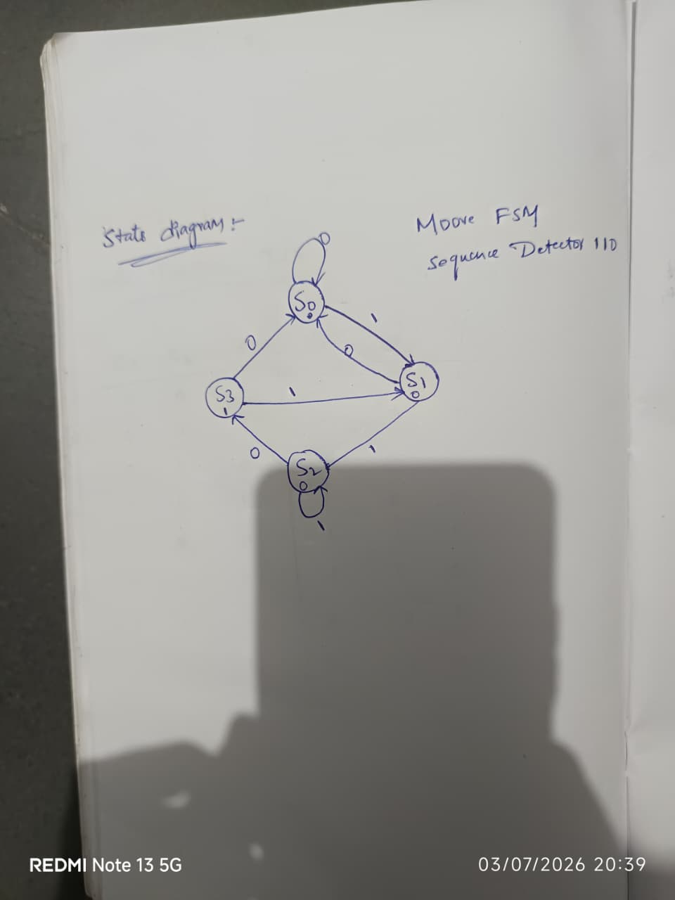
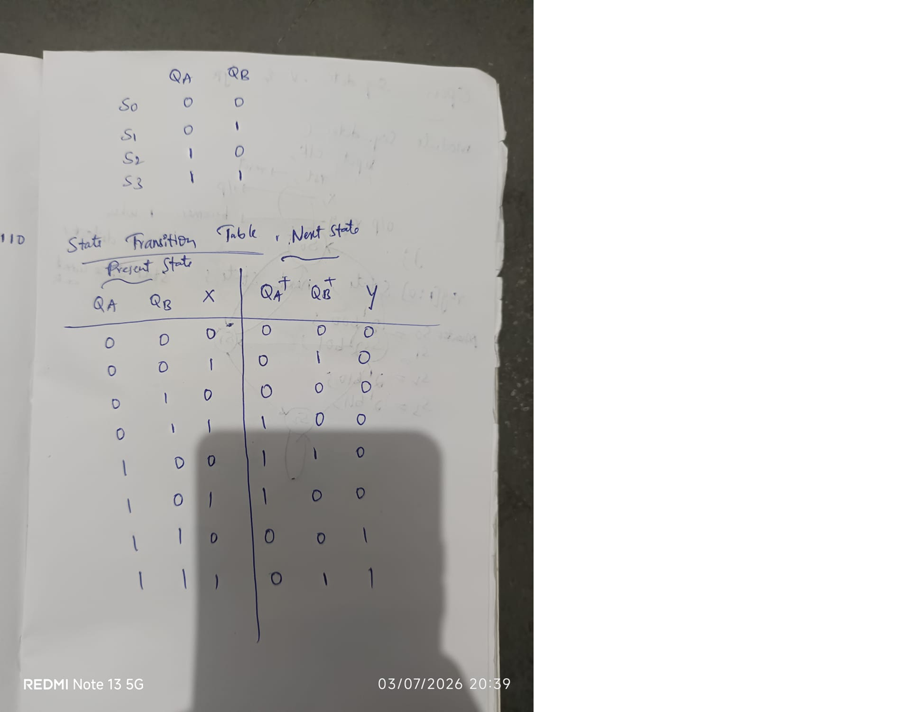
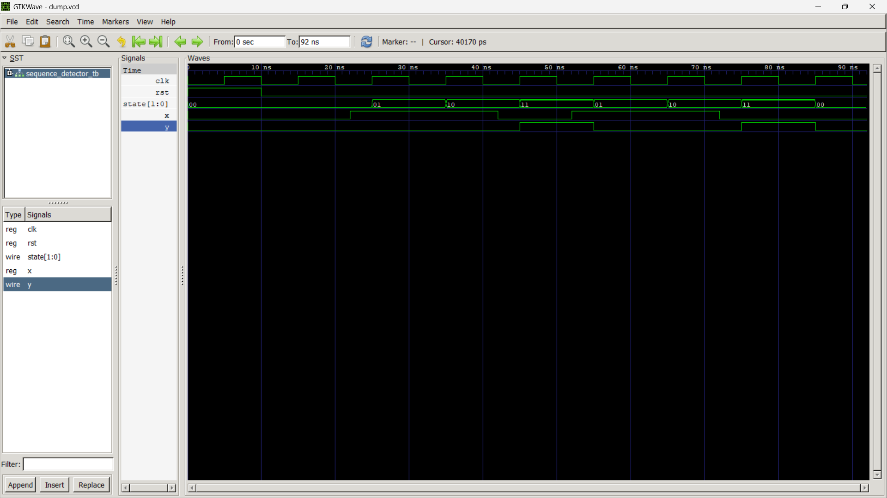

# Sequence Detector - 110

## Description
This project implements a Moore Finite State Machine (FSM) in Verilog to detect the binary sequence **110**.

## Features
- Moore FSM
- Verilog HDL implementation
- Testbench included
- Simulated using Icarus Verilog
- Waveform verified using GTKWave

## Simulation
The waveform confirms that the output `y` becomes HIGH whenever the sequence **110** is detected.

## Files
- `sequence_detector.v` - Verilog design
- `sequence_detector_tb.v` - Testbench
- `state_diagram.png.jpeg` - FSM state diagram
- `state_transition_table.png` - State transition table
- `waveform.png` - Simulation waveform

## How to Simulate
```sh
iverilog -o sequence_detector.vvp sequence_detector.v sequence_detector_tb.v
vvp sequence_detector.vvp      # writes dump.vcd
gtkwave dump.vcd
```

## State Diagram



## State Transition Table



## Simulation Waveform


