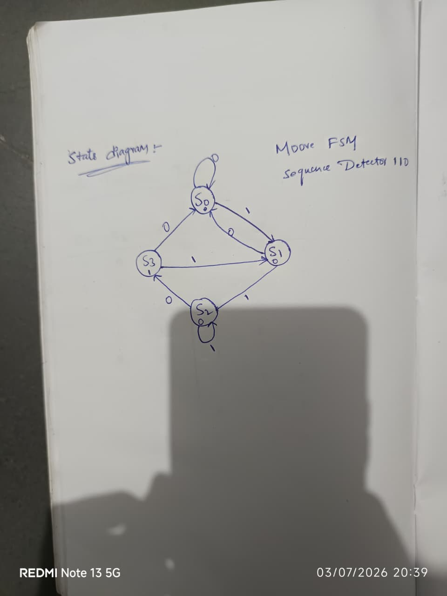
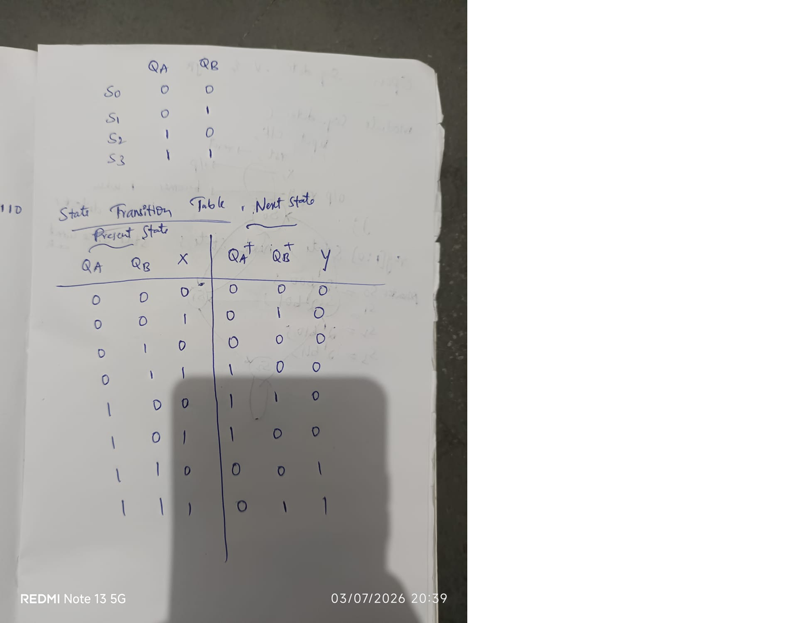
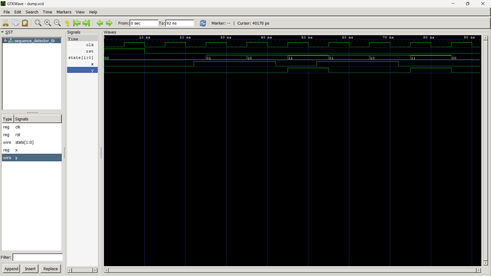

# Sequence Detector - 110

A Moore FSM in Verilog that detects the binary sequence **110**, including overlapping detections. For example, `110110` should raise `y` twice.

`y` is high only in state S3, which is entered on the clock after the completing `0`. From S2 a further `1` stays in S2, so `111` is not flagged as `110`.

## Files

- `rtl/sequence_detector.v` - Verilog design
- `tb/sequence_detector_tb.v` - self-checking testbench
- `state_diagram.png` - FSM state diagram
- `state_transition_table.png` - State transition table
- `waveform.png` - Simulation waveform (from an earlier run)
- `LICENSE`
- `.github/workflows/ci.yml`

## How to Simulate

The testbench checks overlapping `110110`, the non-detection of `111` and `100`, and reset in the middle of a sequence. It prints `RESULT: ALL TESTS PASSED` or `RESULT: FAILED`.

```sh
iverilog -g2012 -o sequence_detector.vvp rtl/sequence_detector.v tb/sequence_detector_tb.v
vvp sequence_detector.vvp      # writes dump.vcd
gtkwave dump.vcd
```

## State Diagram



## State Transition Table



## Simulation Waveform



## License

MIT, see [LICENSE](LICENSE). Copyright (c) 2026 B. Srishanth Reddy.
